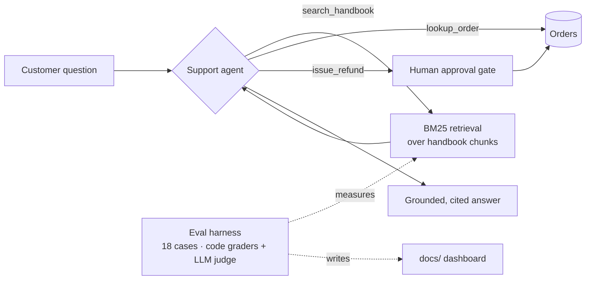

# AI Engineering Lab

[](https://github.com/YOUR_GITHUB_USERNAME/ai-engineering-lab/actions/workflows/ci.yml)
[](https://YOUR_GITHUB_USERNAME.github.io/ai-engineering-lab/)

A hands-on path from a first LLM API call to an **evaluated, tool-using support agent**, built in plain Python on the [Claude API](https://platform.claude.com/docs). Every lesson is a short, runnable script. The project ends with a working agent and an experiment-tracking dashboard.

The running example is **Lumen Bikes**, a fictional bike retailer. Its support bot has to answer policy questions from a handbook, look up orders, and issue refunds, without making up policy.

**→ [Live eval dashboard](https://YOUR_GITHUB_USERNAME.github.io/ai-engineering-lab/)**: accuracy, retrieval recall, cost and latency for every experiment run against the bot.

## What's inside



| | Lesson | You build | Key ideas |
|---|---|---|---|
| 1 | [First call](lessons/01_first_call) | Annotated API calls | tokens & cost, system prompts, effort, stop reasons, refusal fallbacks |
| 2 | [Chat & streaming](lessons/02_chat_streaming) | A streaming chatbot | statelessness, conversation history, prompt caching |
| 3 | [Structured output](lessons/03_structured_output) | An email triage pipeline | Pydantic schemas, LLMs as functions, enums over free text |
| 4 | [Tool use](lessons/04_tool_use) | The agent loop, by hand and with the SDK | `tool_use` → `tool_result`, errors as information, input validation |
| 5 | [RAG](lessons/05_rag) | Retrieval from scratch (BM25) | chunking, grounding, citations, abstaining |
| 6 | [Evals](lessons/06_evals) | An eval harness and dashboard | code graders, LLM-as-judge, quality/cost/latency tradeoffs |
| 7 | [Capstone agent](lessons/07_agent) | [`agents/support_agent.py`](agents/support_agent.py) | agentic RAG, human-in-the-loop, least privilege |

## Quick start

```bash
git clone https://github.com/YOUR_GITHUB_USERNAME/ai-engineering-lab.git
cd ai-engineering-lab
python3 -m venv .venv && source .venv/bin/activate   # Python 3.10+
pip install -r requirements.txt
cp .env.example .env        # then paste your API key into .env

python lessons/01_first_call/main.py
```

Get an API key at [platform.claude.com](https://platform.claude.com/settings/keys). Most lessons cost a few cents to run. A full eval run (lesson 6) costs roughly $0.10–0.30, depending on settings.

## Running experiments

```bash
python lessons/06_evals/main.py --label baseline --top-k 3 --effort low --notes "BM25, section chunks"
python lessons/06_evals/main.py --label "top_k=1" --top-k 1
python -m http.server -d docs 8000      # open http://localhost:8000
```

Each run is appended to [`docs/data/experiments.json`](docs/data/experiments.json). Commit it and push, and the [dashboard](https://YOUR_GITHUB_USERNAME.github.io/ai-engineering-lab/) updates.

## Project layout

```
agents/          the capstone support agent
lab/             shared code: client & cost tracking, BM25 retrieval, RAG pipeline, fake order DB
lessons/NN_*/    one folder per lesson: README (concepts + exercises) and main.py
data/            the Lumen Bikes handbook and the eval set
docs/            the eval dashboard (served by GitHub Pages)
tests/           offline tests, run in CI without an API key
```

## Design choices

- **No frameworks.** The agent loop, retrieval and evals are written out in full, so nothing is hidden behind an abstraction. Once you've built them yourself, frameworks are easy to pick up.
- **BM25 instead of a vector database.** It has no dependencies and you can inspect every score. Lesson 5 discusses when embeddings are worth adding.
- **Evals before optimization.** Retrieval has a known weakness (no stemming). It's left in on purpose, so the fix shows up as a measured gain on the dashboard.
- **Safety in code, not prompts.** Refund approval and amount validation are `if` statements, not instructions the model could be talked out of.

## Learning log

<!-- Keep notes here as you work through the lessons: what surprised you, what you changed, and what the evals showed. Hiring managers read this section. -->

- [ ] Lesson 1 ·
- [ ] Lesson 2 ·
- [ ] Lesson 3 ·
- [ ] Lesson 4 ·
- [ ] Lesson 5 ·
- [ ] Lesson 6 · baseline accuracy: __%
- [ ] Lesson 7 ·

## License

MIT
